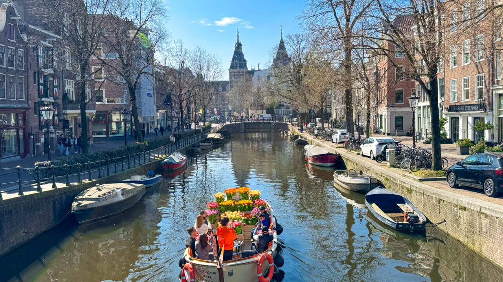
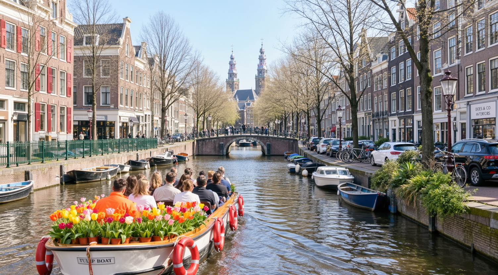

# Example outputs

Unedited outputs from `moss-prompt-enhancer-i2i`.

## Layout mode Image-to-image examples

### 01-amsterdam-canal

Real image:


Generated prompt with instruction `image to image, layout mode`:
```json
{
  "width": 736,
  "height": 1120,
  "bbox_coord_space": "norm1000",
  "bbox_format": "xyxy",
  "summary": {
    "meta": ["photograph", "cityscape", "canal"],
    "canvas": "single",
    "caption": "A bright, sunlit photograph of a canal in Amsterdam, viewed from a boat in the foreground. A boat filled with passengers and vibrant tulips sails toward a bridge, with historic brick buildings and bare trees lining both sides. In the distance, two prominent spires rise above the skyline. The water reflects the sky and structures, and parked cars and bicycles are visible along the right bank. The composition is centered on the canal, with the perspective leading toward the bridge and spires."
  },
  "items": [
    {
      "label": "character",
      "caption": "A group of people on a boat in the foreground. One person wears a bright orange jacket, another wears a white top, and others are in casual clothing. They are seated and looking forward as the boat moves along the canal.",
      "bbox": [355, 730, 558, 980]
    },
    {
      "label": "object",
      "caption": "A boat in the foreground filled with colorful tulips in various shades of orange, yellow, pink, and red. The boat has a white hull with red lifebuoys on the sides and a visible nameplate that reads 'TULIP BOAT'.",
      "bbox": [355, 658, 558, 980]
    },
    {
      "label": "object",
      "caption": "A stone bridge spanning the canal in the midground, with people visible on its walkway. The bridge has a low arch and is flanked by bare trees.",
      "bbox": [400, 420, 580, 480]
    },
    {
      "label": "object",
      "caption": "Two tall, pointed spires rising above the buildings in the background, likely part of a historic church or tower. They are visible through the trees and above the bridge.",
      "bbox": [445, 120, 580, 380]
    },
    {
      "label": "object",
      "caption": "A row of brick buildings lining the left bank of the canal, featuring traditional Dutch architecture with gabled roofs, large windows, and some with red shutters. A few shops are visible, including one with a sign that reads 'DOES & CO INTERIORS'.",
      "bbox": [0, 0, 370, 580]
    },
    {
      "label": "object",
      "caption": "A row of brick buildings lining the right bank of the canal, featuring traditional Dutch architecture with gabled roofs and large windows. Several parked cars and bicycles are visible along the sidewalk.",
      "bbox": [580, 0, 736, 680]
    },
    {
      "label": "object",
      "caption": "Several boats moored along the right bank of the canal, including a small white motorboat and a blue rowboat. Other boats are visible along the left bank.",
      "bbox": [600, 500, 850, 810]
    },
    {
      "label": "object",
      "caption": "A group of bare trees lining both sides of the canal, their branches reaching toward the sky. The trees are mostly leafless, suggesting early spring.",
      "bbox": [0, 0, 736, 580]
    },
    {
      "label": "object",
      "caption": "A row of parked cars along the right bank of the canal, including a white car and a black SUV. Bicycles are also parked along the sidewalk.",
      "bbox": [650, 460, 736, 680]
    },
    {
      "label": "object",
      "caption": "A black street lamp with a classic design, mounted on a pole along the right bank of the canal.",
      "bbox": [800, 330, 840, 580]
    },
    {
      "label": "object",
      "caption": "A green metal fence running along the left bank of the canal, separating the sidewalk from the water.",
      "bbox": [0, 520, 370, 680]
    },
    {
      "label": "object",
      "caption": "A small patch of greenery with shrubs and plants along the right bank of the canal, near the parked cars.",
      "bbox": [700, 460, 880, 580]
    },
    {
      "label": "object",
      "caption": "A white car parked on the right bank of the canal, near the bicycles.",
      "bbox": [650, 460, 736, 520]
    },
    {
      "label": "object",
      "caption": "A black SUV parked on the right bank of the canal, near the edge of the frame.",
      "bbox": [880, 540, 990, 680]
    },
    {
      "label": "object",
      "caption": "A white sign on a building on the right bank, reading 'DOES & CO INTERIORS' in black capital letters.",
      "bbox": [880, 370, 990, 400]
    }
  ]
}
```

Image reference using the generated layout prompt:



### 02-promotional-banner

Real image:


Generated prompt with instruction `image to image, layout mode`:
```json
{
  "width": 736,
  "height": 1120,
  "bbox_coord_space": "norm1000",
  "bbox_format": "xyxy",
  "summary": {
    "meta": ["poster", "digital illustration"],
    "canvas": "single",
    "caption": "A vibrant, high-energy Black Friday sale advertisement with a dynamic orange and black color scheme. The composition is dominated by bold, stylized text elements with distressed edges, set against a background of diagonal orange stripes. The overall mood is urgent and promotional."
  },
  "items": [
    {
      "label": "text",
      "caption": "White, uppercase, sans-serif text reading 'LIMITED TIME ONLY', angled diagonally in the upper left.",
      "text": "LIMITED TIME ONLY",
      "bbox": [95, 150, 375, 330]
    },
    {
      "label": "text",
      "caption": "White, bold, uppercase, sans-serif text 'BLACK FRIDAY' on a black, textured, angled banner with distressed edges.",
      "text": "BLACK FRIDAY",
      "bbox": [170, 130, 610, 620]
    },
    {
      "label": "text",
      "caption": "Orange, bold, uppercase, sans-serif text 'SALE' on a white, textured, angled banner with distressed edges.",
      "text": "SALE",
      "bbox": [440, 370, 770, 840]
    },
    {
      "label": "text",
      "caption": "White, uppercase, sans-serif text 'GET UPTO 50% OFF', angled diagonally in the lower right.",
      "text": "GET UPTO 50% OFF",
      "bbox": [560, 680, 870, 880]
    }
  ]
}
```

Image reference using the generated layout prompt:

