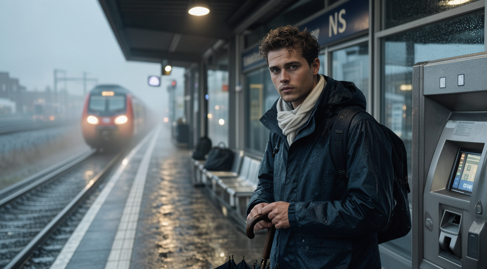
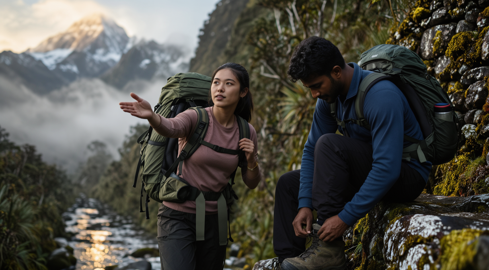
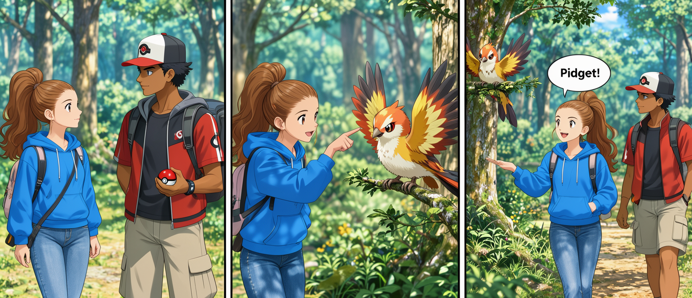
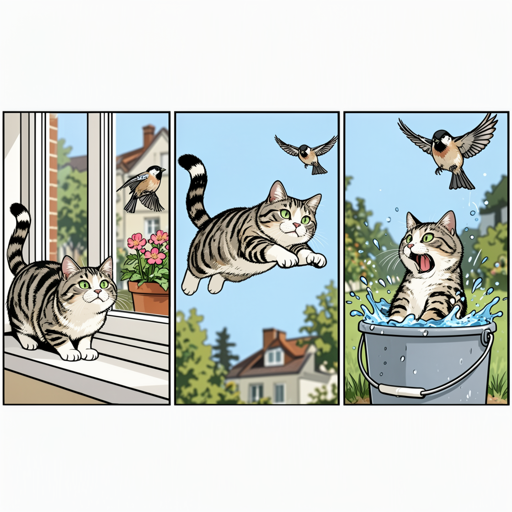

# Example outputs

Unedited outputs from `moss-prompt-enhancer` (one run each) for cases in [inputs.jsonl](inputs.jsonl). Output varies between runs; compare against the checks in [../tests/evaluation.md](../tests/evaluation.md), not word for word.

## 01-person-no-details

Input: `a woman reading in a cafe`

```text
A young White woman in her late twenties with auburn hair tied in a loose bun, wearing a cream sweater and a denim jacket, sits at a wooden café table with a book open on her lap. Her fingers trace the pages as she reads, one leg crossed over the other, a steaming mug of coffee beside her. Soft natural light filters through a large window behind her, casting gentle shadows on the table and highlighting the texture of the book cover. The background features a minimalist bookshelf with a few novels and a small potted plant, while the café's warm, inviting atmosphere is enhanced by the glow of a pendant lamp. The composition focuses on her engaged expression and the quiet rhythm of her reading, with a soft, photorealistic style capturing the calm of the scene.
```


## 02-ethnicity-from-location

Input: `a street food vendor at a night market in Seoul`

```text
A Korean woman in her late 30s, wearing a bright red apron over a white headscarf, flips a sizzling beef burger on a charcoal grill at a bustling Seoul night market. Her hands are covered in soot from the flames, and her eyes are focused on the sizzling meat. Behind her, a crowd of customers gathers around a row of stalls selling grilled meats, street snacks, and Korean souvenirs. Neon signs in Korean and English cast a warm glow over the scene, reflecting off the wet pavement and the glossy surface of a nearby street food cart. The shot is a medium close-up from slightly below eye level, with sharp focus on her hands and the glowing grill, while the background remains softly blurred to emphasize the vibrant energy of the market. The lighting highlights the textures of the food and the vendor's apron, creating a lively, photorealistic atmosphere.
```


## 03-age-and-ethnicity-supplied

Input: `a 17-year-old Black girl blowing bubbles in a park`

```text
A Black girl of about seventeen with natural curls and a bright floral dress stands in a sunlit park, holding a wand to blow bubbles. Her face is tilted upward as she watches the rainbow-colored bubbles float into the sky, her eyes wide with wonder. The scene is framed by a tree-lined path and a patch of freshly mowed grass, with dappled sunlight filtering through the canopy. A few nearby children and parents are visible in the background, and a small pond reflects the sky's blue tones. Soft natural light highlights the texture of her dress and the shimmer of the bubbles, creating a warm, playful atmosphere. Natural photographic style.
```


## 04-minimalist-no-person

Input: `a red apple on a white table`

```text
A deep red apple with a glossy surface, slightly gradient from light to dark red, rests on a smooth white wooden table. The apple's stem is visible, and a faint shadow under it suggests soft natural light coming from the upper left. The table's surface has a subtle grain texture, and the background is a clean, uncluttered white space. The composition focuses on the apple with shallow depth of field, emphasizing its vibrant color and reflective quality. Photorealistic style with soft lighting and natural shadows.
```


## 05-role-implies-age

Input: `a grandmother knitting by a window, watercolor style`

```text
A White European woman in her late seventies, with silver-streaked hair in a loose bun and warm, crinkled eyes, sits by a large bay window knitting a chunky wool scarf. Her hands move steadily as she holds two wooden knitting needles, with a skein of pale blue yarn draped over her arm. Soft afternoon light filters through lace curtains, casting gentle shadows on the wooden floor and highlighting the texture of the yarn. Behind her, a faint outline of a flower garden and a brick-paved path peek through the window, blurred into a watercolor gradient. The scene is rendered in soft, blended hues of beige, soft green, and pale blue, with subtle washes of light reflecting off the yarn and window glass. A small mug of steaming tea sits on the windowsill beside a stack of books. The composition emphasizes the quiet, contemplative mood of the moment with a naturalistic, watercolor painting style.
```


## 06-dutch-context

Input: `a commuter waiting on the platform of a Dutch train station on a rainy morning`

```text
A Dutch commuter in his late twenties, wearing a dark waterproof jacket and a light scarf, stands near a ticket machine on a rain-slicked platform. His eyes are fixed on the tracks as a train approaches, his fingers tapping a damp umbrella handle. The platform is lined with sleek steel benches and a faded "NS" (Dutch Railways) sign, with a few scattered luggage bags. Rain streaks the glass windows of the station, and mist clings to the ground, blending the horizon with the sky in a soft grey haze. The lighting is diffused, with light reflecting off wet surfaces and creating a cool, moody atmosphere. A single overhead light casts gentle shadows on the commuter's face, emphasizing the dampness of his coat and the quiet tension of waiting. Naturalistic photographic style.
```



## 07-multiple-people

Input: `two friends hiking in the Andes`

```text
A young East Asian woman in her mid-twenties and a South Asian man in his early thirties trek through a misty Andean trail, their backpacks slung over one shoulder. The woman gestures toward a distant snow-capped peak, while the man adjusts his hiking boots on a rocky outcrop. Dense cloud forests line the path, with vibrant green moss clinging to ancient stone. A narrow stream glistens below, reflecting the soft golden light of morning. The composition focuses on their shared determination, with shallow depth of field blurring the rugged landscape behind them. Naturalistic photographic style, emphasizing textured fabrics, realistic lighting, and the raw beauty of the Andes.
```



## 08-counts

Input: `three cats sleeping on a sofa`

```text
A trio of cats sleeping on a modern dark-blue sofa in a cozy living room. A tabby cat with striped orange and gray fur curls into a ball on the left, its tail wrapped around a fluffy pillow. A solid black cat lies on its back in the center, paws splayed, with a small sunbeam illuminating its fur. A calico cat rests on the right, its tail draped over the edge of the sofa, one paw raised as if dreaming. The room features a wooden coffee table with a stack of books and a floor lamp casting soft shadows. Warm, diffused light from a window bathes the scene in golden tones, emphasizing the cats' fur textures and the sofa's fabric. Natural photographic style with shallow depth of field, highlighting the cats' peaceful slumber.
```


## 11-quote-not-rendered

Input: `an illustration inspired by the sentence "the sea remembers every ship"`

```text
A serene, ethereal illustration of a vast ocean at twilight, with soft pastel blues and silvers dominating the palette. The surface of the water ripples with faint, glowing patterns resembling the outlines of countless ships—some ancient, some modern—etched into the waves like memories. In the distance, a lone ship glides through the horizon, its silhouette faintly glowing, while a ghostly mermaid figure with flowing hair and a crown of seaweed floats beneath the surface, her hands outstretched as if cradling the sea's recollections. The composition blends realism with surrealism, using soft light and dreamlike textures to evoke the ocean's timeless memory.
```


## 12-visible-text-caption

Input: `a wooden shop sign that reads "Mill & Marrow" hanging above a bakery door`

```text
A rustic wooden sign with hand-carved letters "Mill & Marrow" in a bold, slightly weathered script hangs from a wrought-iron hook above a small bakery door. The sign is painted in a soft oak tone with a faint grain texture, its edges slightly splintered to suggest age. The door below is a dark cherry wood with a glass panel, displaying a warm glow from interior lighting. A small brass handle juts from the door, and a tiny bell hangs beside it, casting a faint shadow. The scene is bathed in soft, golden afternoon light filtering through a nearby window, highlighting the wood's natural texture and the sign's faded paint. The atmosphere is cozy and inviting, with a subtle hint of cinnamon scent in the air. Natural photographic style.
```


## 14-explicit-caption-for-poster

Input: `Caption mode, not layout: a vintage travel poster of a lighthouse with the text "VISIT THE COAST"`

```text
A vintage-style travel poster featuring a towering white lighthouse with a red stripe, standing on a rugged coastal cliff against a dramatic sky. The lighthouse beam pierces the clouds, illuminating the dark, rolling sea below. Below the structure, a small fishing boat cuts through waves, while a sandy beach stretches toward the horizon. Bold, hand-lettered text in dark blue reads "VISIT THE COAST" at the top, framed by a decorative border of waves and sea shells. The overall palette is warm and nostalgic, with sepia tones and soft gradients evoking a bygone era of travel. The composition balances the lighthouse as the central focal point, with the sea and sky enhancing the sense of adventure. Artistic, slightly faded photographic style with a touch of retro illustration.
```


## 15-poster-layout

Input: `Layout mode, 1024x1536: a jazz concert poster. Title "SUMMER JAZZ NIGHT", below it "Friday 8 PM\nBlue Door Cafe". A saxophone player in the middle.`

```json
{
  "width": 1024,
  "height": 1536,
  "bbox_coord_space": "abs",
  "bbox_format": "xyxy",
  "summary": {
    "meta": ["poster", "illustration"],
    "canvas": "single",
    "caption": "A vibrant jazz concert poster with a dark-blue background and gold accents. The title 'SUMMER JAZZ NIGHT' dominates the top, followed by the subtitle 'Friday 8 PM\nBlue Door Cafe' in smaller text. A dynamic saxophone player is centered, surrounded by musical notes and a glowing stage effect."
  },
  "items": [
    {
      "label": "text",
      "caption": "Large bold gold capital letters with slight gradient, centered at the top with a subtle shadow.",
      "text": "SUMMER JAZZ NIGHT",
      "bbox": [128, 128, 896, 320]
    },
    {
      "label": "text",
      "caption": "Smaller gold sans-serif text, aligned below the title with a faint outline.",
      "text": "Friday 8 PM\nBlue Door Cafe",
      "bbox": [256, 384, 768, 544]
    },
    {
      "label": "object",
      "caption": "A stylized black saxophone player in motion, mid-solo with a glowing red light, surrounded by floating jazz notes and a neon stage border. The player's face is partially visible with a determined expression.",
      "bbox": [192, 576, 832, 1280]
    }
  ]
}
```


## 16-layout-incompatible-size

Input: `Layout mode, 1000x700: a product shot of a ceramic mug with the text "MORNING" next to it`

```json
{
  "width": 1000,
  "height": 700,
  "bbox_coord_space": "abs",
  "bbox_format": "xyxy",
  "summary": {
    "meta": ["product shot", "illustration"],
    "canvas": "single",
    "caption": "A minimalist product shot of a hand-thrown ceramic mug with a matte white glaze, placed against a soft gray background. The word 'MORNING' in bold uppercase sans-serif font sits to the right of the mug, styled in a light beige color for readability."
  },
  "items": [
    {
      "label": "object",
      "caption": "A ceramic mug with a smooth, matte white glaze and a subtle handcrafted texture, placed on a light gray background. The handle curves gently, and the rim has a slight inward slope.",
      "bbox": [200, 100, 800, 600]
    },
    {
      "label": "text",
      "caption": "Bold uppercase sans-serif text in light beige, aligned to the right of the mug with a slight shadow for contrast.",
      "text": "MORNING",
      "bbox": [820, 100, 1000, 600]
    }
  ]
}
```

The dimensions are kept at 1000x700 even though they are not multiples of 16.


## 17-animated-story

Input: `Layout mode, short anime themed story with three boxes. box 1: 2 pokemon players, one anime girl and a guy. boks 2: They spot a pokemon in the wild. boks 3: the girl says it is only a pidget and they walk away.`

```json
{
  "width": 1024,
  "height": 1024,
  "bbox_coord_space": "abs",
  "bbox_format": "xyxy",
  "summary": {
    "meta": ["anime", "illustration"],
    "canvas": "multi_panel",
    "caption": "A three-panel anime-style story in a sunlit forest clearing. Panel 1: Two Pokémon trainers meet. Panel 2: They spot a wild Pokémon. Panel 3: The girl identifies it as a Pidget and they walk away."
  },
  "items": [
    {
      "label": "object",
      "caption": "Left panel: A White European girl in her early teens with light brown hair in a high ponytail, wearing a blue hoodie and jeans, stands beside a South Asian guy in his late teens with dark hair and a baseball 
cap, holding a Poké Ball. Both look toward the forest.",
      "bbox": [0, 0, 341, 1024]
    },
    {
      "label": "object",
      "caption": "Center panel: The girl and guy stand in a sunlit forest clearing, pointing at a small, fluffy Pidget Pokémon perched on a low branch. The bird Pokémon fluffs its wings and tilts its head.",
      "bbox": [341, 0, 682, 1024]
    },
    {
      "label": "object",
      "caption": "Right panel: The girl confidently says 'Pidget!' in a speech bubble, while the guy nods. They walk away from the tree, the Pidget remaining on its branch. Soft shadows and vibrant colors emphasize the anime 
style.",
      "bbox": [682, 0, 1024, 1024]
    }
  ]
}
```



## 18-implicit-layout

Input: `A multi-panel comic strip of three panels: a cat sees a bird, the cat jumps, the cat misses and falls in a bucket`

```json
{
  "width": 1024,
  "height": 1024,
  "bbox_coord_space": "abs",
  "bbox_format": "xyxy",
  "summary": {
    "meta": ["comic strip", "illustration"],
    "canvas": "multi_panel",
    "caption": "A three-panel comic strip in a horizontal layout, drawn with bold outlines and flat colors. A cat chases a bird, leaps through the air, and lands in a bucket with a comedic expression."
  },
  "items": [
    {
      "label": "object",
      "caption": "Left panel: a tabby cat with green eyes crouches on a windowsill, tail flicking as it locks onto a small bird perched on a flowerpot outside.",
      "bbox": [32, 32, 320, 992]
    },
    {
      "label": "object",
      "caption": "Center panel: the cat leaps into the air with front paws extended, mid-motion, its body arched back as the bird flaps away in the background.",
      "bbox": [384, 32, 640, 992]
    },
    {
      "label": "object",
      "caption": "Right panel: the cat lands awkwardly in a large plastic bucket filled with water, legs splayed, and tilts its head with a surprised expression as the bird soars above.",
      "bbox": [640, 32, 992, 992]
    }
  ]
}
```



## 19-exclusions

Input: `a mountain lake at dawn, no people, no boats`

```text
A serene mountain lake at dawn, surrounded by misty peaks and dense evergreen forests. The surface of the water mirrors the pale gold sky and the dark silhouettes of distant mountains, with gentle ripples from a light breeze. Early morning light filters through the trees, casting soft shadows on the forest floor and highlighting dewdrops on grass blades. No human presence or vessels are visible, emphasizing the untouched natural beauty. The atmosphere is calm and ethereal, with a cool, misty quality. Natural photographic style with soft lighting and realistic textures.
```


## 20-photoreal-portrait

Input: `close-up portrait of a bearded man in a leather jacket, photorealistic`

```text
A close-up portrait of a White man in his early forties with a thick, well-groomed beard and a sharp, angular jawline, wearing a dark brown leather jacket with visible stitching and a few scuff marks. His eyes are focused on the camera, with a faint crease between his brows suggesting contemplation. The jacket's texture is rendered with realistic leather grain, and the light catches the surface in soft highlights. The background is a softly blurred, dimly lit room with faint shadows on the walls. Natural studio lighting models his face with gentle shadows, emphasizing fine facial textures and the contrast between his beard and the smooth skin around it. Shallow depth of field with a slightly tilted camera angle, in a natural, unretouched photographic style.
```


## Known issues

These outputs do not meet the checks in [../tests/evaluation.md](../tests/evaluation.md) and are left out above.

- **Output language (13-output-language):** The input `Write the prompt in Chinese: 一只橘猫坐在窗台上看雨` returned an unrelated Chinese sentence (a chef plating a dessert, taken from a few-shot example) instead of describing the orange cat.
- **Missing age and ethnicity (P1, P4):** `10-anime` describes a "young anime-style girl" with no age or ethnicity.
- **Invented visible text (C6):** `09-non-human` added a sign reading "STARLIGHT".
- **Wrong label (L4):** In `15-poster-layout` above, the saxophonist is labeled `object` instead of `character`.
- **Layout copy (L10):** `17-infographic-no-copy` invented an extra text line not in the prompt.
- **Variety (P7):** With no indicators, ethnicity choices lean toward a few defaults (mostly White or East Asian).

Note: layout drafts must still be converted to the centered `yxyx` form with the compiler script from the official MOSS-Image skill before being pasted into MOSS-Image.
